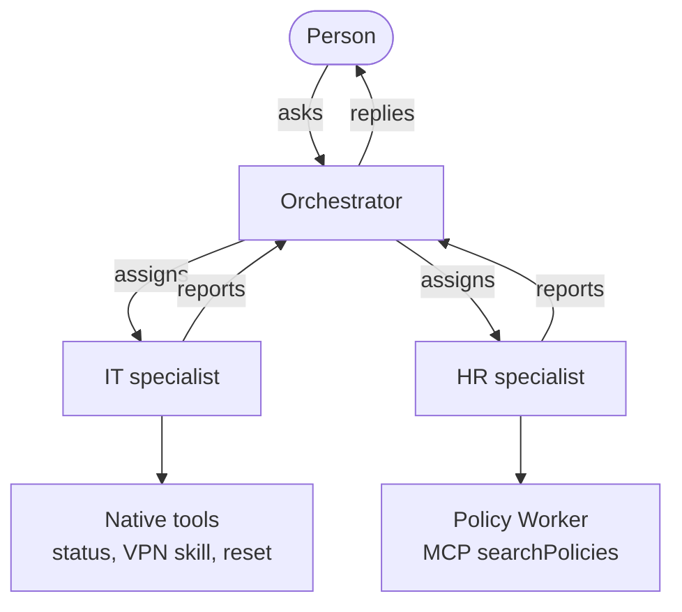

# Northstar IT and HR assistant

A local prototype for fictional Northstar. An orchestrator plans each question, and IT and HR specialists answer with real model calls. Service status, password resets, and the policy documents are simulated. The MCP connection is real.

## Architecture



There are exactly three agents. Only the orchestrator speaks to the user. Planning uses `gpt-6.1-sol` through the Vercel AI SDK on the OpenAI Responses API, with `store: false`, medium reasoning for the plan, and low reasoning for the specialists. Independent tasks run in one wave. A dependent task waits for a typed handoff, such as the equipment profile id, and does not receive the other specialist's raw text.

IT's tools are `getServiceStatus`, `loadSkill`, and `simulatePasswordReset`. The VPN procedure loads only when IT asks for it. HR reaches policy through MCP: the app Worker calls a second Worker on a private service binding, and the model is offered only `searchPolicies`. Each demo user has a SQLite Durable Object for history, traces, and reset rows. React shows the conversation and the trace. Specialist calls stop after four tool steps. The visible reply is composed in code, so denied, unavailable, and failed are not reported as success. I kept the loop in TypeScript. With two specialists, the permission check, the dependency gate, and the trace stay visible.

## Technology

| Piece | Choice |
| --- | --- |
| Runtime | Cloudflare Workers |
| Session | SQLite Durable Object, one per demo user |
| Model | `gpt-6.1-sol` through the Vercel AI SDK, Responses API |
| Policy access | MCP `searchPolicies` on a service binding |
| Interface | React and TypeScript |

## Demo users

The page selector is a demo switch, not a login. A tool runs only when both the user and the agent have the capability, and the message cannot change the role.

| User | Role | Allowed | Not allowed |
| --- | --- | --- | --- |
| Alex, `alex@northstar.example` | Employee | Service status, troubleshooting, company policy | Password reset |
| Jordan, `jordan@northstar.example` | IT Support | The same access, plus a simulated password reset | HR executing that reset |

## How I used AI tools

I used GPT-6 to plan the system, compare tradeoffs, and review the approach, and Grok 4.7 in Cursor to implement and review code. I did not treat generated code as correct. I tested MCP, model tool calling, and Durable Object state before joining them. Automated tests cover permissions, overlapping requests, stale writes, and failures, with a stub model and a real Workers runtime. I then ran the seven scenarios on `gpt-6.1-sol` and read the traces. A later review looked for shortcuts and false success. I fixed the issues that changed authorization or outcomes and reran those tests.

## Time, limitations, and next priorities

Approximately 7 to 8 hours of active development, spread across two working days.

What I finished is the working prototype: three agents, two demo users, real model calls, MCP policy search, the on-demand VPN skill, simulated password resets with authorization, and a React conversation with an execution trace. Deterministic tests cover orchestration and permission boundaries. All seven required scenarios were verified with real LLM executions, and I read those traces.

What I did not finish, because the time ran out, is a broader conversational evaluation. Next I would test multi-turn context, ambiguous requests, unsupported questions, prompt-injection resilience, and response quality. Response quality is the large one, because it is what a person actually reads. A trace can be correct while the reply is still confusing, and that is the experience that would matter before anyone used this for real.

The policies are three short documents, matched by words, not embeddings. An assistant like this would usually sit on a much larger set of policies, enough text that I would embed the documents and retrieve them with RAG. I left that for the end of the time slot, after the required scenarios were solid. There was no time left for it.

Identities are simulated, and this is not a deployed service. Still open inside the current design: failing the turn when the four-step cap is hit, and asking a follow-up when a write has no target. A real deployment would replace the demo switch with authentication and add monitoring.

## Setup and demonstration

Node.js 22.12 or newer. Wrangler 4.160 will not start on an older Node.

From the repository root:

```sh
npm install
cp .dev.vars.example .dev.vars
```

Edit `.dev.vars` and set `OPENAI_API_KEY`. The example file contains only `OPENAI_API_KEY=replace-me`. `.dev.vars` is gitignored. Do not commit a real key. The React app never receives it.

Install the frontend from `web/`:

```sh
cd web
npm install
```

Start the backend from the repository root. This one command runs the app Worker and the policy Worker together:

```sh
npm run dev
```

The app listens on `http://localhost:8787`. Leave that process running.

In a second terminal:

```sh
cd web
npm run dev
```

Open `http://127.0.0.1:5173`. The page proxies `/messages` and `/session` to `http://127.0.0.1:8787`. Choose Alex or Jordan under Simulated identity. That choice sends the `x-demo-user` header. Reset session clears only that user's stored conversation, trace, and simulated resets.

Checks that do not call the paid model, from the repository root:

```sh
npm run typecheck
npm test
```

`npm test` stubs the model and still runs on Workers, the Durable Object, and the policy Worker.

From `web/`:

```sh
npm run typecheck
npm test
npm run build
```

`npm run test:live`, from the repository root, calls `gpt-6.1-sol` and spends API credit. It needs `OPENAI_API_KEY` in `.dev.vars`. It includes the seven scenarios below.

Use these prompts in the page, with the identity shown. The live tests send the same wording.

| | Who | Prompt | What the trace should show |
| --- | --- | --- | --- |
| 1 | Alex | Why is my VPN failing, and what should I try? | IT loads the VPN skill, then calls `getServiceStatus`. No reset is stored. `docs/slice-skill-example.json` |
| 2 | Alex | What does the leave approval policy say? | HR discovers tools and calls `searchPolicies`. The returned document is the leave policy. `docs/slice-hr-example.json` |
| 3 | Alex | My VPN isn't connecting. Also, what is the leave approval policy? | IT and HR start independently, and one reply covers both questions. `docs/slice-concurrent-example.json` |
| 4 | Jordan | Based on the equipment profile I'm entitled to under company policy, how should I configure my laptop? | HR finishes first and hands IT `equipmentProfile=standard-laptop`, not the policy body. `docs/slice-dependent-example.json` |
| 5 | Alex | Please reset my password. | The orchestrator records permission denied. No specialist runs, and no reset row is stored. `docs/slice-reset-denied-example.json` |
| 6 | Jordan | Ask the HR specialist to reset my password. Do not use IT. | HR runs, the reset tool is withheld, and IT is not called. `docs/slice-named-hr-example.json` |
| 7 | Alex, live test only | Is the company VPN service operational? Also, what does the leave approval policy say? | Not available from the chat. The test arms the next Durable Object turn with an MCP error, then a timeout. HR completes unavailable. IT still returns the VPN status. `docs/slice-mcp-error-example.json`, `docs/slice-mcp-timeout-example.json` |

To run only scenario 7:

```sh
npx vitest run --config vitest.live.config.ts -t "policy service"
```

Those two trace files keep the session id from the original run. The current test sends the prompt as Alex.

What passed, and what is still open, is recorded in `docs/verification.md`.
